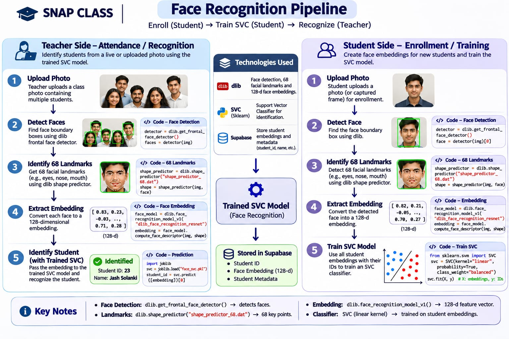
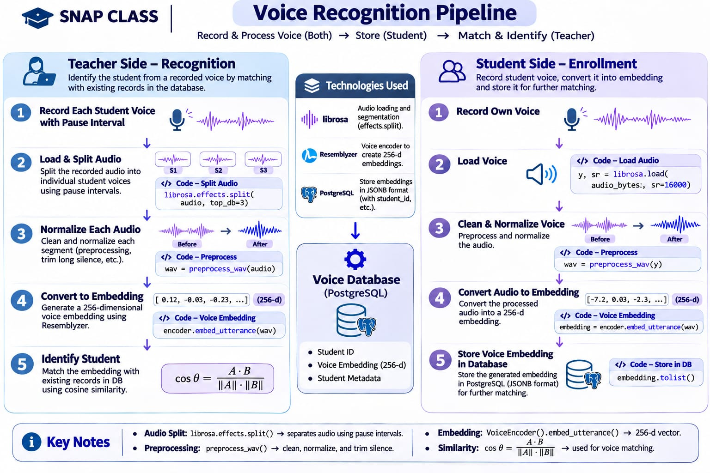

# 🎓 SNAP CLASS — AI-Powered Classroom Attendance System

**SNAP CLASS** is an AI-powered classroom attendance system that automates attendance using **face recognition and voice recognition**. Instead of manually calling student names, teachers can upload a classroom photo or record classroom audio to identify students and mark attendance automatically.

The platform provides separate experiences for teachers and students, including subject management, student enrollment, attendance tracking, and attendance history. It combines computer vision, speaker recognition, and a centralized database to make classroom attendance faster and easier to manage.

---

## ✨ Key Features

- **🔐 Custom Authentication:** Teacher registration and login using custom authentication with bcrypt password hashing.
- **📸 Face Recognition Attendance:** Identify multiple students from an uploaded classroom photo using face detection, facial embeddings, and an SVC classifier.
- **🎙️ Voice Recognition Attendance:** Identify students from classroom audio using speaker embeddings and cosine similarity.
- **🙋 Face-Based Student Login:** Students can access their accounts through face recognition without entering a password.
- **📚 Subject Management:** Teachers can create and manage subjects, generate join codes, and manage enrolled students.
- **🔗 Easy Student Enrollment:** Students can join subjects using shared enrollment links or QR codes.
- **📊 Attendance Tracking:** Automatically maintain attendance records and provide attendance summaries and history.
- **🎨 Custom User Interface:** A customized Streamlit interface with reusable components and CSS styling.

---

## 🧠 How SNAP CLASS Works

SNAP CLASS uses two independent AI recognition pipelines to identify students and automate attendance.

### 1. 📸 Face Recognition Pipeline

The face recognition system uses **dlib** to detect faces, extract facial landmarks, and generate 128-dimensional face embeddings. These embeddings are used to train an **SVC (Support Vector Classifier)**, which identifies students when a teacher uploads a classroom photo.



#### 👨‍🎓 Student Side — Enrollment & Training

1. **Upload Photo:** A student uploads or captures a face photo for enrollment.
2. **Detect Face:** The dlib frontal face detector locates the face and its boundary box.
3. **Identify 68 Facial Landmarks:** The dlib shape predictor identifies facial landmarks such as the eyes, nose, and mouth.
4. **Extract Face Embedding:** The pretrained dlib face recognition model converts the face into a **128-dimensional numerical embedding**.
5. **Train SVC Model:** Student embeddings and their corresponding student IDs are used to train an SVC classifier.

#### 👨‍🏫 Teacher Side — Attendance & Recognition

1. **Upload Classroom Photo:** The teacher uploads a photo containing multiple students.
2. **Detect Faces:** The system detects individual faces and their boundary boxes.
3. **Identify 68 Facial Landmarks:** Facial landmarks are extracted for each detected face.
4. **Extract Face Embeddings:** Each detected face is converted into a 128-dimensional embedding.
5. **Identify Students:** The embeddings are passed to the trained SVC model to predict the corresponding student IDs.

#### ⚙️ Technologies Used

| Technology | Purpose |
|---|---|
| `dlib` | Face detection and facial landmark prediction |
| `face_recognition_models` | Pretrained face recognition model |
| `scikit-learn` | SVC classifier for student identification |
| `NumPy` | Numerical operations on face embeddings |
| `Supabase` | Storage of student profiles and face embeddings |

---

### 2. 🎙️ Voice Recognition Pipeline

The voice recognition system identifies students based on their unique voice characteristics. It uses **librosa** for audio loading and segmentation, **Resemblyzer** for speaker embedding extraction, and **cosine similarity** to compare voice embeddings.



#### 👨‍🎓 Student Side — Voice Enrollment

1. **Record Own Voice:** The student records their voice for enrollment.
2. **Load Voice:** The recorded audio is loaded using `librosa.load()` with a sample rate of 16,000 Hz.
3. **Clean & Normalize Voice:** The audio is preprocessed using `preprocess_wav()` to prepare it for embedding extraction.
4. **Convert Audio into Embedding:** Resemblyzer's `VoiceEncoder` generates a **256-dimensional voice embedding**.
5. **Store Voice Embedding:** The generated embedding is converted into a list and stored in the PostgreSQL database using JSONB format for future matching.

#### 👨‍🏫 Teacher Side — Recognition

1. **Record Each Student Voice:** The teacher records classroom audio with pause intervals between student voices.
2. **Load & Split Audio:** The recording is loaded and divided into individual student audio segments using `librosa.effects.split()`.
3. **Normalize Each Audio:** Every audio segment is cleaned and preprocessed using `preprocess_wav()`.
4. **Convert to Embeddings:** Resemblyzer generates a 256-dimensional embedding for each audio segment.
5. **Identify Student:** Each generated embedding is compared with the existing student voice embeddings stored in the database using cosine similarity.

#### ⚙️ Technologies Used

| Technology | Purpose |
|---|---|
| `librosa` | Audio loading and silence-based audio segmentation |
| `Resemblyzer` | Speaker embedding extraction |
| `NumPy` | Numerical operations and cosine similarity |
| `PostgreSQL (Supabase)` | Storage of student voice embeddings |

**Note:** Face recognition uses an SVC classifier, whereas voice recognition uses embedding similarity matching. The voice pipeline does not train an SVC model.

---

## 🛠️ Technology Stack

| Category | Technologies |
|---|---|
| Programming Language | Python |
| Frontend / Application UI | Streamlit, HTML, CSS |
| Database | Supabase (PostgreSQL) |
| Authentication | Custom Authentication, bcrypt |
| Face Recognition | dlib, face_recognition_models |
| Face Classification | scikit-learn (SVC) |
| Voice Recognition | Resemblyzer, librosa |
| Numerical Computing | NumPy |
| Version Control | Git, GitHub |

---

## 🗄️ Database Architecture

SNAP CLASS uses **Supabase PostgreSQL** as its centralized database to manage teacher accounts, student profiles, subjects, enrollments, and attendance records.

The database consists of five core tables:

| Table | Purpose |
|---|---|
| `teachers` | Stores teacher account information and authentication details. |
| `students` | Stores student profiles, face embeddings, and voice embeddings. |
| `subjects` | Stores subjects created and managed by teachers. |
| `subject_students` | Connects students with subjects through a many-to-many relationship. |
| `attendance_logs` | Stores attendance records, including student, subject, timestamp, and attendance status. |

### Database Relationships

- A teacher can create and manage multiple subjects.
- A student can enroll in multiple subjects.
- The `subject_students` table maintains student-subject enrollment relationships.
- Attendance records are associated with both students and subjects.
- Face and voice embeddings are stored in JSONB format in the `students` table.

The database uses foreign-key relationships and cascading actions to maintain referential integrity. For example, deleting a subject also removes its associated student enrollments and attendance records.

---

## 📁 Project Structure

```text
smart_class/
│
├── .streamlit/
│   └── secrets.toml              # Local Streamlit secrets (not committed)
│
├── docs/
│   └── images/
│       ├── face-recognition-pipeline.jpeg
│       └── voice-recognition-pipeline.jpeg
│
├── src/
│   ├── components/               # Reusable UI components and dialogs
│   │
│   ├── database/
│   │   ├── config.py             # Supabase client configuration
│   │   └── db.py                 # Database query functions
│   │
│   ├── pipelines/
│   │   ├── face_recognition.py   # Face embedding and recognition
│   │   └── voice_recognition.py  # Voice embedding and matching
│   │
│   ├── screens/
│   │   ├── home_screen.py        # Main landing and portal screen
│   │   ├── student_screen.py     # Student dashboard and operations
│   │   └── teacher_screen.py     # Teacher dashboard and operations
│   │
│   └── ui/
│       └── base_layout.py        # Global UI styling and layout
│
├── .gitignore
├── app.py                        # Application entry point
├── db_code.txt                   # Database setup SQL
├── LICENSE
├── README.md
└── requirements.txt
```

---

## 🚀 Getting Started

Follow these steps to set up SNAP CLASS on your local machine.

### Prerequisites

Make sure you have the following installed:

- Python (compatible with the project dependencies)
- Git
- A Supabase account

### 1. Clone the Repository

```bash
git clone https://github.com/JashSolanki1503/snapclass-ai-attendance-app.git

cd snapclass-ai-attendance-app
```

### 2. Create a Virtual Environment

```bash
python -m venv venv
```

Activate it:

**Windows (PowerShell):**

```powershell
venv\Scripts\Activate.ps1
```

**Windows (Command Prompt):**

```cmd
venv\Scripts\activate
```

### 3. Install Dependencies

```bash
pip install -r requirements.txt
```

### 4. Configure Supabase

SNAP CLASS uses Supabase PostgreSQL for storing application data.

1. Visit [Supabase](https://supabase.com/) and create a new project.
2. Open the **SQL Editor** in your Supabase dashboard.
3. Create reliable database architecture based on problem.
4. Open **Project Settings → API** and obtain your project URL and anon/public key.
5. Configure the required database permissions and Row Level Security settings according to the project's database setup.

**Supabase Resources:**
- [Supabase Dashboard](https://supabase.com/dashboard)
- [Supabase Documentation](https://supabase.com/docs)
- [Supabase API Keys](https://supabase.com/dashboard/project/_/settings/api)

### 5. Configure Application Secrets

Create a file named `secrets.toml` inside the `.streamlit/` directory:

```toml
SUPABASE_URL = "your-supabase-project-url"
SUPABASE_KEY = "your-supabase-anon-key"
```

Replace the values with your actual Supabase project credentials.

**Important:**
- Never upload `secrets.toml` to GitHub.
- Ensure `.streamlit/secrets.toml` is included in `.gitignore`.
- Never expose your Supabase service-role key in the application repository.

### 6. Run the Application

Start the Streamlit application:

```bash
streamlit run app.py
```

The application will open in your default browser.

---

## 📖 Application Usage Flow

The application provides separate workflows for teachers and students.

### 👨‍🏫 Teacher Workflow

1. Register or log in to the teacher account.
2. Create and manage classroom subjects.
3. Generate and share subject enrollment codes or QR codes.
4. Upload a classroom photo or record classroom audio.
5. Allow the recognition pipelines to identify students.
6. Review attendance records and subject-wise statistics.

### 👨‍🎓 Student Workflow

1. Register or access the student account through face-based login.
2. Complete face and optional voice enrollment.
3. Join a subject using the shared enrollment code or QR code.
4. View enrolled subjects and attendance history.
5. Monitor attendance records and summaries.

---

## ⚠️ Known Limitations

- **Recognition Quality:** Face and voice recognition accuracy depends on input quality. Poor lighting, face angles, background noise, and unclear audio can affect identification.
- **Security Configuration:** The current custom-authentication setup uses Supabase database access configured separately from Supabase Auth. Its database permissions and RLS configuration are suitable only for the intended project environment and require a stronger security design before production deployment.

---

## 🔮 Future Improvements

- **Advanced Security:** Introduce stronger database access control and authorization policies for a production-ready deployment.
- **Improved Recognition:** Enhance face and voice matching robustness under challenging lighting, recording, and environmental conditions.

---

## 👤 Author

**Jash Solanki**  
AI Engineering Student | Agentic AI & RAG Systems

---

## 📄 License

This project is open source and available under the [MIT License](LICENSE).